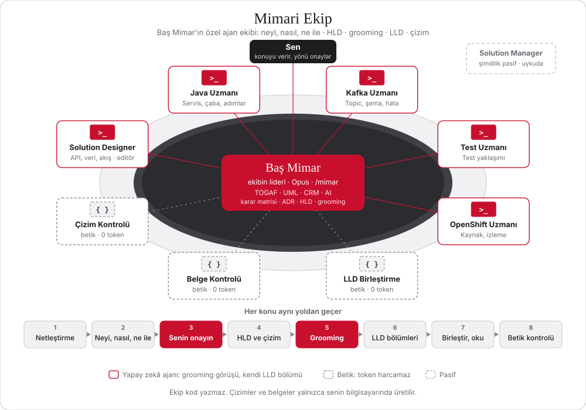

# agile-team

Çözüm Mimarı'nın özel danışma kurulu: HLD, LLD, ADR ve yerel draw.io çizimleri. Ortam: Spring Boot ve OpenShift üzerinde Kafka.



Plan çizimi: [docs/architecture/ekip-plani.drawio](docs/architecture/ekip-plani.drawio)

## Ekip
Bu ekip kod yazmaz. Çözüm Mimarı'nın danışma kuruludur: neyi, nasıl ve ne ile yapacağımızı netleştirir, HLD, LLD, ADR ve çizimleri üretir.

| Rol | Ajan | Groomingden sonra yazdığı LLD bölümleri |
|---|---|---|
| Çözüm Mimarı | `solution-architect` | Lider; karar matrisi, ADR, HLD, grooming kaydı |
| Solution Designer | `solution-designer` | Kapsam, API, veri modeli, akışlar, güvenlik, açık sorular; LLD editörü |
| Java Uzmanı | `java-expert` | Servis ve modül yapısı, yapılandırma, uygulama adımları |
| Kafka Uzmanı | `kafka-expert` | Topic ve olay şemaları, hata ve yeniden deneme |
| Test Uzmanı | `test-expert` | Test yaklaşımı |
| OpenShift Uzmanı | `openshift-expert` | OpenShift kaynakları, gözlemlenebilirlik |

Her iş, dokümanlar üzerinde bütün ekiple groom edilir; herkes görüşünü söyler ve LLD'nin kendi bölümünü yazar.

## Kurulum
```bash
claude plugin marketplace add ~/Desktop/projects/agile-team
claude plugin install agile-team@agile-team-local
```

Bir değişiklikten sonra `plugin.json` ve `marketplace.json` içindeki sürümü artır, ardından:

```bash
claude plugin marketplace update agile-team-local
claude plugin update agile-team@agile-team-local
```

## Kullanım
Dokümanları bir klasöre koy ve tek komut yaz:

```text
/agile-team:mimar <doküman klasörü> [iş adı]
```

1. Ekip dokümanları okur, herkes yorumunu getirir.
2. Çözüm Mimarı yorumları ve kararları gösterir, sen **tamam** diyene kadar bekler.
3. Sonra sırayla: mimari çizim, UML tasarım, HLD, LLD, son kontrol.

Çıktılar `docs/architecture/` altına yazılır.

## Gizlilik
Depo özeldir. Çizimler yalnızca yerel `.drawio` dosyası olarak üretilir, uzak bir servise gönderilmez. Şirkete ait kod, müşteri verisi ve gizli anahtar bu depoya konmaz.

## Lisans
Kişisel kullanım içindir. `skills/drawio/SKILL.md` jgraph/drawio-mcp projesinden alınmıştır (Apache-2.0), bkz. `skills/drawio/NOTICE`.
